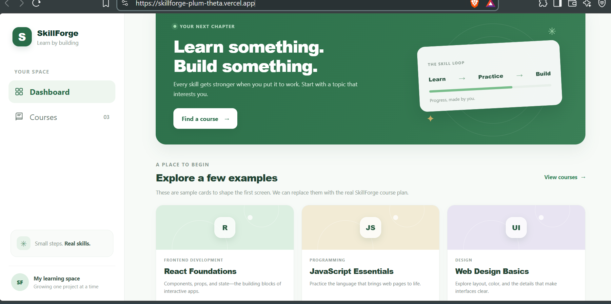
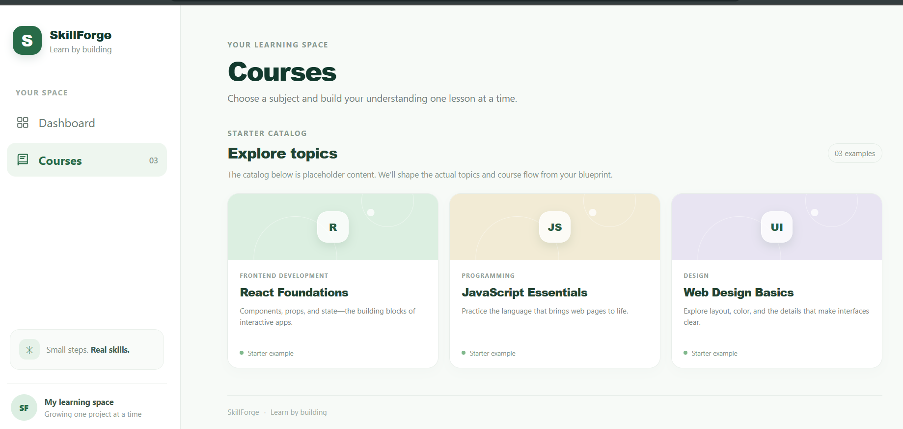

# SkillForge

> **Learn by building.**

SkillForge is a learning workspace designed to make learning technical
skills more structured, focused, and practical. It provides a clean
interface for exploring courses and organizing learning around topics,
with an emphasis on turning learning into building.

## 🌐 Live Demo

**[Open SkillForge](https://skillforge-plum-theta.vercel.app/)**

## 📌 Overview

SkillForge is currently a frontend-focused project built with Vite. The
application provides a learning dashboard and course catalog where users
can explore learning topics such as React, JavaScript, and Web Design.

The project is designed around a simple idea:

**Learn → Practice → Build**

Instead of treating learning as only consuming content, SkillForge is
intended to provide a workspace where users can move from learning a
concept to applying it in projects.

## ✨ Current Features

-   Clean learning-focused dashboard
-   Sidebar navigation between Dashboard and Courses
-   Course catalog with topic cards
-   Course categories and descriptions
-   Responsive card-based learning interface
-   Visual progress-oriented "Learn → Practice → Build" concept
-   Green-focused visual design with a minimal interface
-   Deployed and accessible online through Vercel

## 🖥️ Screenshots

### Dashboard



### Courses



> Add the screenshots to a `screenshots/` folder in the repository using
> the filenames `dashboard.png` and `courses.png`.

## 🛠️ Tech Stack

-   **React** --- UI development
-   **Vite** --- Development server and build tooling
-   **JavaScript** --- Application logic
-   **HTML5** --- Page structure
-   **CSS3** --- Styling and layout
-   **Git & GitHub** --- Version control
-   **Vercel** --- Deployment

## 📂 Project Structure

A typical structure for the project is:

``` text
SkillForge/
├── public/
├── src/
│   ├── assets/
│   ├── components/
│   ├── ...
├── index.html
├── package.json
├── vite.config.js
└── README.md
```

The exact structure may evolve as new features are added.

## 🚀 Run Locally

### 1. Clone the repository

``` bash
git clone https://github.com/pkpiku/SkillForge.git
cd SkillForge
```

### 2. Install dependencies

``` bash
npm install
```

### 3. Start the development server

``` bash
npm run dev
```

Vite will provide a local development URL, usually:

``` text
http://localhost:5173
```

### 4. Create a production build

``` bash
npm run build
```

To preview the production build locally:

``` bash
npm run preview
```

## 🎯 Project Goals

SkillForge is being developed with the following goals:

-   Create a distraction-free learning workspace
-   Organize technical learning into clear topics and courses
-   Encourage learning through practical application
-   Provide a simple foundation that can grow into a more complete
    learning platform
-   Practice modern frontend development and UI design

## 🔮 Planned Improvements

Some possible future improvements include:

-   [ ] Real course content and lesson pages
-   [ ] Interactive course/lesson navigation
-   [ ] User authentication
-   [ ] Personal learning progress
-   [ ] Topic completion tracking
-   [ ] Project-based learning paths
-   [ ] Backend API
-   [ ] Database integration
-   [ ] User profiles
-   [ ] Persistent learning data
-   [ ] Improved mobile responsiveness

## 📈 Development Philosophy

SkillForge is built around the idea that progress comes from applying
what you learn.

``` text
        Learn
          ↓
       Practice
          ↓
         Build
          ↓
     Real Skills
```

## 👨‍💻 Author

**Piku**

GitHub: [@pkpiku](https://github.com/pkpiku)

## 📄 License

This project is currently intended as a personal learning and portfolio
project.
